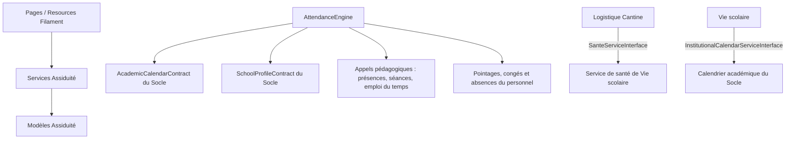

# Module Assiduité

## Rôle

Assiduité traite les pointages bruts et produit une vue journalière de
présence pour les élèves et le personnel. Il suit aussi les anomalies,
justifications et rapports associés. Le code contient également des
parcours de santé, sorties, visiteurs et réclamations, qui ont des
concepts proches dans Vie scolaire : consulter leurs contrats et modèles
avant de modifier l’un de ces parcours.

## Parcours Filament

Les pages de `Filament/Pages/` couvrent :

- `AssiduiteDashboard` et `AssiduiteSection` : synthèse et navigation ;
- `PresencesEleves`, `PointagePersonnel` : consultation et pointage ;
- `AbsencesRetards`, `JustificationsAnomalies` : suivi et traitement ;
- `RapportsAssiduite` : rapports.

Les Resources de `Filament/Resources/` sont `PointageBrutResource`,
`AssiduiteJournaliereResource`, `AnomalieAssiduiteResource`,
`JustificationAssiduiteResource`, ainsi que les Resources des parcours
présents de santé, visites à l’infirmerie, sorties, visiteurs et
réclamations. Chaque Resource possède ses Pages de liste et, selon le
parcours, de création/modification.

## Modèles et relations

| Groupe | Classes | Responsabilité |
|---|---|---|
| Pointage et calcul | `PointageBrut`, `AssiduiteJournaliere`, `AssiduiteHistorique`, `AnomalieAssiduite` | Entrées brutes, résultat journalier, historique de recalcul et anomalies à examiner. Une assiduité journalière expose ses historiques ; une anomalie peut référencer son responsable. |
| Justification | `JustificationAssiduite` | Motif/décision attachés à une personne et une date ; une justification acceptée peut modifier le statut calculé. |
| Santé et visites | `DossierSante`, `VisiteInfirmerie` | Informations de santé et actes/visites associés à un élève ; une visite identifie l’élève et le personnel qui la traite. |
| Accueil | `Visiteur` | Entrée/sortie de visiteur, personne visitée par relation polymorphe et agent ayant enregistré l’entrée. |
| Sorties | `SortieEleve` | Sortie normale ou exceptionnelle, élève, parent/personne autorisée et personnel remettant l’élève. |
| Réclamations | `Reclamation`, `ReclamationHistoriqueStatut` | Réclamation avec auteur polymorphe, responsable, transitions et historique des changements de statut. |

Ces modèles appartiennent à `App\Modules\Assiduite\Models`. Leur
présence dans ce module ne signifie pas que toutes les données de même nom
de Vie scolaire sont fusionnées : vérifier la Resource, le contrat et le
provider réellement utilisés.

## Moteur et services

`AttendanceEngine` implémente `AttendanceEngineInterface`. Pour une personne
de type `eleve` ou `personnel`, il :

1. vérifie le calendrier et les données de présence/pointage du jour ;
2. calcule un statut, sa source, un niveau de confiance et des détails ;
3. tient compte d’une justification acceptée ;
4. crée ou met à jour `AssiduiteJournaliere` ;
5. peut ajouter une anomalie et, lors d’un recalcul avec changement de
   statut, écrire dans l’historique.

Les autres services locaux sont `SanteService`, `SortieEleveService`,
`VisiteurService` et `ReclamationService`. Ils réalisent les opérations
spécifiques à leurs parcours plutôt que de porter la logique de calcul du
moteur.

Le provider lie `AttendanceEngineInterface` à `AttendanceEngine`, ainsi que
les contrats locaux de santé, sortie, visiteur et réclamation à leurs
services. `PresenceServiceInterface` est également déclaré dans
`Contracts/`, mais n’est pas lié par le provider actuel.

## Communications et flux

- Le moteur consomme le calendrier académique et le profil établissement
  par contrats du Socle. Il utilise les appels pédagogiques pour déduire la
  présence d’un élève et les informations RH pour calculer la présence du
  personnel.
- Les sorties vérifient les liens parent/élève auprès de Scolarité et
  peuvent transmettre un justificatif aux services documentaires du Socle.
- Les services d’autres modules doivent dépendre des contrats exposés et
  liés par `AssiduiteServiceProvider`; ils ne doivent pas importer les
  modèles internes d’Assiduité.
- Logistique utilise le contrat de santé exposé par Vie scolaire pour
  vérifier les alertes alimentaires nécessaires à la cantine.

## Installation et évolutions

`Providers/AssiduiteServiceProvider.php` enregistre les contrats, charge
les migrations dans `database/migrations/` et les vues Blade sous
`assiduite::`. Les pages utilisent les services, qui écrivent dans les
modèles de ce module. Aucun dossier `Jobs/` ni contrôleur HTTP actif n’est
présent actuellement.

Pour ajouter une règle, modifier le service concerné et son contrat avant
d’adapter la Resource. Pour une nouvelle donnée, vérifier d’abord si le
concept est déjà porté par Vie scolaire ou Pédagogie ; ne créer une table
qu’après avoir déterminé le propriétaire effectif des données.
