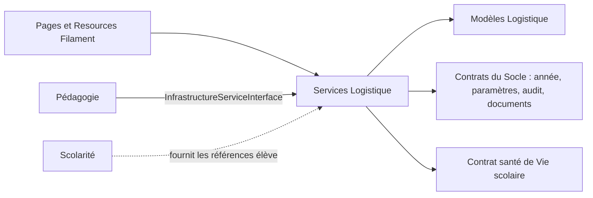

# Module Logistique

## Rôle

Logistique administre les moyens matériels et services collectifs de
l’établissement : espaces et travaux, équipements, maintenance,
bibliothèque, cantine, transport scolaire et événements. Il gère ses
propres ressources et opérations. Les élèves, années scolaires,
autorisations, documents et paramètres généraux restent la responsabilité
de Scolarité ou du Socle.

## Parcours Filament

Les pages du module sont dans `Filament/Pages/` :

- `LogistiqueDashboard` et `LogistiqueSection` pour l’accueil et la
  navigation par domaine ;
- `Infrastructures` pour les salles, travaux et interventions ;
- `EquipementsMaintenance` pour le patrimoine, les pannes et l’entretien ;
- `Bibliotheque` pour les livres, exemplaires et emprunts ;
- `Cantine` pour menus, abonnements et présences aux repas ;
- `TransportScolaire` pour véhicules, circuits et inscriptions.

Les Resources dans `Filament/Resources/` portent les formulaires, listes,
filtres et actions d’administration : `SalleResource`,
`TravauxInfrastructureResource`, `DemandeInterventionResource`,
`EquipementResource`, `PlanMaintenancePreventiveResource`,
`LivreResource`, `AbonnementCantineResource`, `VehiculeResource`,
`CircuitTransportResource` et `EvenementResource`. Les Pages `Create`,
`Edit` et `List` associées composent les parcours Filament de ces Resources.
Les relation managers gèrent notamment l’historique de localisation des
équipements, les participants et les photos des événements.

## Modèles et groupes de données

| Domaine | Modèles principaux | Liens du domaine |
|---|---|---|
| Espaces et infrastructure | `Salle`, `TravauxInfrastructure`, `DemandeIntervention` | Une salle porte équipements, interventions et travaux ; une intervention est rattachée à un équipement et peut préciser une salle. |
| Patrimoine et maintenance | `Equipement`, `EquipementHistoriqueLocalisation`, `PlanMaintenancePreventive` | Un équipement référence sa salle, ses historiques de déplacement, interventions et plans préventifs. |
| Bibliothèque | `Livre`, `ExemplaireLivre`, `Emprunt`, `ReservationLivre` | Un livre possède des exemplaires ; les emprunts portent sur un exemplaire et identifient l’emprunteur de façon polymorphe. |
| Cantine | `MenuCantine`, `AbonnementCantine`, `PresenceCantine` | Les présences quotidiennes se rattachent à un abonnement ; celui-ci référence l’élève et l’année scolaire. |
| Transport | `Vehicule`, `CircuitTransport`, `ArretCircuit`, `InscriptionTransport`, `PresenceTransport`, `IncidentTransport` | Un circuit utilise un véhicule et possède des arrêts ; les inscriptions référencent un élève, un circuit et un arrêt. |
| Événements | `Evenement`, `EvenementParticipant`, `EvenementPhoto` | Un événement regroupe participants et photos ; les documents d’autorisation parentale sont gérés par le service d’événements. |

Les modèles sont internes à `App\Modules\Logistique\Models`. Un module
consommateur ne doit pas accéder directement à ces modèles.

## Services et contrats

Les règles métier et opérations inter-domaines sont portées par les classes
de `Services/`. Le `LogistiqueServiceProvider` lie les contrats publics aux
implémentations :

| Contrat | Implémentation | Usage principal |
|---|---|---|
| `InfrastructureServiceInterface` | `InfrastructureService` | Lister les salles utilisables, déclarer une salle hors service, planifier et terminer des travaux. |
| `EquipementServiceInterface` | `EquipementService` | Enregistrer/déplacer un équipement, déclarer une panne ou une mise au rebut, consulter la valeur du patrimoine et les garanties. |
| `MaintenanceServiceInterface` | `MaintenanceService` | Traiter les interventions et maintenances préventives. |
| `BibliothequeServiceInterface` | `BibliothequeService` | Emprunter, retourner ou réserver un exemplaire et consulter les retards/historiques. |
| `CantineServiceInterface` | `CantineService` | Abonner un élève, enregistrer sa présence et vérifier la compatibilité allergène d’un menu. |
| `TransportServiceInterface` | `TransportService` | Inscrire un élève dans un circuit, enregistrer une présence de trajet et suivre incidents/occupation. |
| `EvenementServiceInterface` | `EvenementService` | Créer un événement, inscrire/confirmer les participants, conserver l’autorisation parentale et clôturer l’événement. |

Les validations de capacité, disponibilité, garantie et état passent par
les services et leurs exceptions métier dans `Exceptions/`.

## Communications

- Pédagogie peut demander des salles via `InfrastructureServiceInterface`
  pour préparer l’emploi du temps ; elle ne doit pas lire `Salle` directement.
- Les services obtiennent l’année courante et les capacités transverses du
  Socle par contrat (par exemple année scolaire, paramètres, documents et
  audit).
- `CantineService` consulte `SanteServiceInterface` de Vie scolaire pour les
  informations d’urgence/allergies. Il ne consulte pas le dossier médical
  complet pour cette vérification.
- Les identifiants d’élève proviennent de Scolarité. Logistique conserve ses
  inscriptions et présences de service, pas un référentiel parallèle
  d’élèves.

## Enregistrement et configuration

`LogistiqueServiceProvider` enregistre les bindings, charge les migrations
de `database/migrations/` et les vues Blade sous le namespace
`logistique::`. Le code actuel ne contient pas de dossier `Jobs/` ni de
contrôleurs HTTP propres au module.

## Où intervenir

- Une règle métier ou une écriture : `Services/` et le contrat associé.
- Un modèle ou un lien persistant : `Models/` et les migrations Logistique.
- Une page d’opération : `Filament/Pages/` ; une gestion CRUD : sa Resource
  et ses Pages.
- Une intégration intermodule : ajouter/utiliser un contrat, puis enregistrer
  son binding dans le provider concerné. Ne pas importer un modèle ou un
  service interne d’un autre module.
