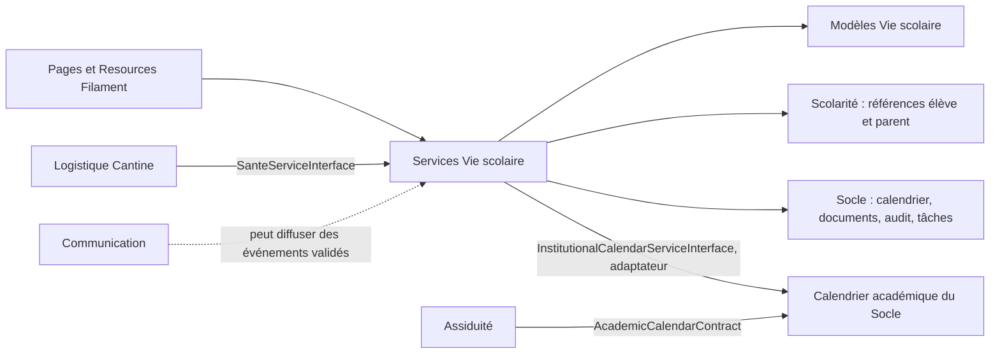

# Module Vie scolaire

## Rôle

Vie scolaire suit les événements et incidents de la vie quotidienne des
élèves, le calendrier institutionnel, les visites à l’infirmerie, les
sorties, les visiteurs et les réclamations. Le module fournit également des
interfaces de santé et de calendrier à ses consommateurs. Scolarité reste
propriétaire des élèves, parents et inscriptions ; le Socle fournit les
services transverses comme calendrier, documents et tâches.

## Parcours Filament

Les Pages dans `Filament/Pages/` sont :

- `VieScolaireDashboard` et `VieScolaireSection` pour la synthèse et les
  entrées du module ;
- `CalendrierEvenements` pour le calendrier et les événements ;
- `IncidentsReclamations` et `RapportsHistorique` pour le suivi et les
  rapports ;
- `SanteInfirmerie`, `SortiesEleves` et `Visiteurs` pour les opérations
  quotidiennes correspondantes.

Les Resources dans `Filament/Resources/` sont
`CalendrierInstitutionnelResource`, `EvenementScolaireResource`,
`IncidentVieScolaireResource`, `DossierSanteResource`,
`VisiteInfirmerieResource`, `SortieEleveResource`, `VisiteurResource` et
`ReclamationResource`. Leurs Pages de liste/création/modification
constituent les formulaires de gestion. Les vues Blade du module sont
chargées sous le namespace `vie-scolaire::`.

## Modèles et relations

| Groupe | Classes | Relations / rôle |
|---|---|---|
| Incidents | `IncidentVieScolaire`, `IncidentVieScolaireHistorique` | Un incident garde une collection d’historiques. |
| Santé | `DossierSante`, `VisiteInfirmerie` | Dossier d’un élève et visites; les visites enregistrent leur élève et la personne qui les traite. |
| Sorties et visiteurs | `SortieEleve`, `Visiteur` | Sorties liées à l’élève, au parent et à la personne qui remet l’élève ; les visiteurs enregistrent une personne visitée polymorphe et l’agent d’accueil. |
| Réclamations | `Reclamation`, `ReclamationHistoriqueStatut` | Une réclamation conserve ses transitions et l’historique de statut. |

Les modèles sont dans `App\Modules\VieScolaire\Models`. Les modèles
`SortieEleve`, `Visiteur`, `DossierSante`, `VisiteInfirmerie` et
`Reclamation` existent également dans Assiduité. Ces noms recouvrent des
implémentations séparées : il ne faut pas supposer que les deux classes
pointent sur les mêmes tables ou que leur historique est synchronisé.
Avant d’étendre un parcours, suivre le binding du contrat jusqu’au service
et vérifier le modèle utilisé par sa Resource.

## Services, contrats et provider

| Contrat | Service | Responsabilité |
|---|---|---|
| `InstitutionalCalendarServiceInterface` | `InstitutionalCalendarService` | Adaptateur des questions calendrier — établissement ouvert, jour d’enseignement et impact sur personnel/élèves — vers le calendrier académique du Socle. |
| `SanteServiceInterface` | `SanteService` | Créer/consulter un dossier de santé, enregistrer une visite et fournir un résumé d’urgence. |
| `SortieEleveServiceInterface` | `SortieEleveService` | Enregistrer les sorties normales ou exceptionnelles et consulter l’historique. |
| `VisiteurServiceInterface` | `VisiteurService` | Enregistrer entrées/sorties, lister les visiteurs présents et vérifier une autorisation de récupération. |
| `ReclamationServiceInterface` | `ReclamationService` | Signaler, affecter, répondre et clôturer une réclamation ; l’affectation crée une tâche via le contrat du Socle. |

`VieScolaireServiceProvider` lie ces interfaces à leurs classes concrètes,
charge `database/migrations/` et enregistre les vues sous le namespace
`vie-scolaire::`.

## Communications

- Les services emploient les contrats de Scolarité pour retrouver les
  élèves/parents et ceux du Socle pour documents, audit, calendrier et
  tâches. L’interface du calendrier est un adaptateur du contrat académique
  du Socle.
- Assiduité a son propre `AttendanceEngine` et dépend du calendrier de
  l’établissement. Vie scolaire ne calcule donc pas le statut journalier
  de présence à sa place.
- Logistique consomme `SanteServiceInterface` pour la vérification
  d’allergènes de cantine, au moyen des seules informations d’urgence
  requises.
- Les domaines médicaux et les incidents ne doivent être exposés qu’aux
  profils autorisés ; employer le résumé d’urgence lorsqu’il suffit au
  consommateur plutôt que consulter tout un dossier.

## Organisation technique

- `Contracts/` : interfaces de service consommables par d’autres modules.
- `Services/` : règles de calendrier, santé, sorties, visiteurs et
  réclamations.
- `Models/` : données persistées appartenant à Vie scolaire.
- `Filament/Pages/` et `Filament/Resources/` : navigation, tableaux et
  formulaires d’administration.
- `database/migrations/` : schéma géré par le provider du module.
- `Exceptions/` : erreurs métier ciblées, notamment autorisation et dossier
  santé absent.

Le module ne contient actuellement ni dossier `Jobs/` ni contrôleurs HTTP
propres. Pour ajouter un consommateur intermodule, utiliser un contrat et
son binding, pas une dépendance directe vers un modèle ou service interne.
