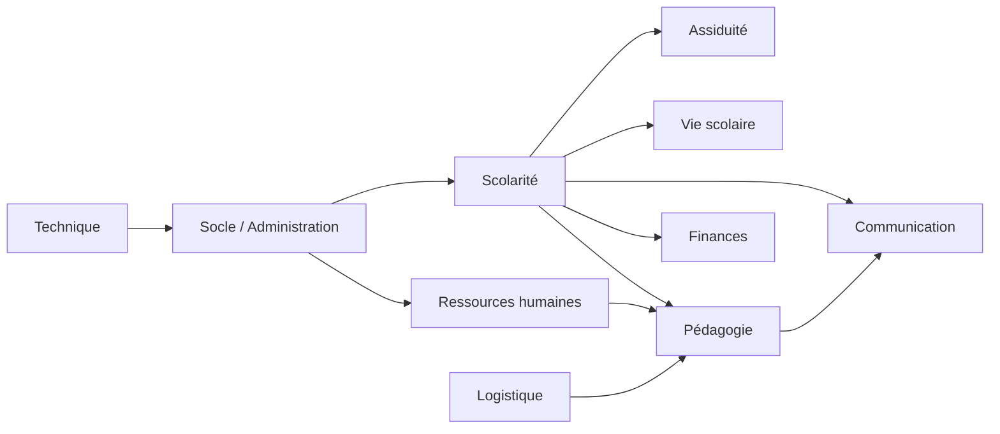

# Architecture d’Ambassadors ERP

Ce dossier décrit l’architecture réellement utilisée par l’application. Il complète les guides de développement et ne remplace pas les règles métier détaillées.

Chaque fichier de module présente son objectif, ses modèles, ses services, ses contrats, ses écrans Filament, ses traitements asynchrones et ses dépendances autorisées.

| Module | Fiche |
| --- | --- |
| Socle | [socle.md](socle.md) |
| Administration | [administration.md](administration.md) |
| Ressources humaines | [rh.md](rh.md) |
| Scolarité | [scolarite.md](scolarite.md) |
| Pédagogie | [pedagogie.md](pedagogie.md) |
| Finances | [finances.md](finances.md) |
| Assiduité | [assiduite.md](assiduite.md) |
| Vie scolaire | [vie-scolaire.md](vie-scolaire.md) |
| Logistique | [logistique.md](logistique.md) |
| Communication | [communication.md](communication.md) |
| Technique | [technique.md](technique.md) |

## Principes communs

- Laravel modulaire : chaque domaine vit sous `app/Modules/<Module>`.
- Filament fournit les Resources, Pages et Widgets d’administration ; le style commun est dans `app/Filament/Support`.
- Les Resources Filament affichent et orchestrent ; les Services portent les règles métier, validations, transactions et audits.
- Les Contracts sont la frontière entre modules. Un module consomme le contrat d’un autre module, jamais son modèle ou son service interne.
- Les Models Eloquent représentent les données dont leur module est propriétaire. Les identifiants des autres modules sont stockés sans relation Eloquent directe lorsque la frontière l’exige.
- Les migrations sont chargées par les Service Providers des modules. Elles sont additives pour préserver l’historique.
- Le Socle fournit année scolaire, référentiels, documents, audit, habilitations et workflows ; les autres modules s’y raccordent par Contracts.
- Les événements et jobs sont employés pour les traitements non immédiats : communications WhatsApp, analyse de programmes et supervision technique.

## Carte des responsabilités

Les flèches indiquent une fourniture de données ou de contrats, pas un accès direct aux tables d’un autre module.

## Cycle de développement

1. Identifier le module propriétaire de la donnée.
2. Réutiliser son Contract ou en créer un minimal si la lecture/écriture doit être exposée.
3. Mettre la règle métier dans un Service testable.
4. Ajouter ou adapter une migration additive et les index nécessaires.
5. Raccorder l’écran Filament avec les composants visuels partagés.
6. Ajouter les tests métier et les tests d’interface utiles.
7. Exécuter les tests concernés, Pint et Deptrac ; toute nouvelle violation Deptrac doit être résolue, pas ignorée.
