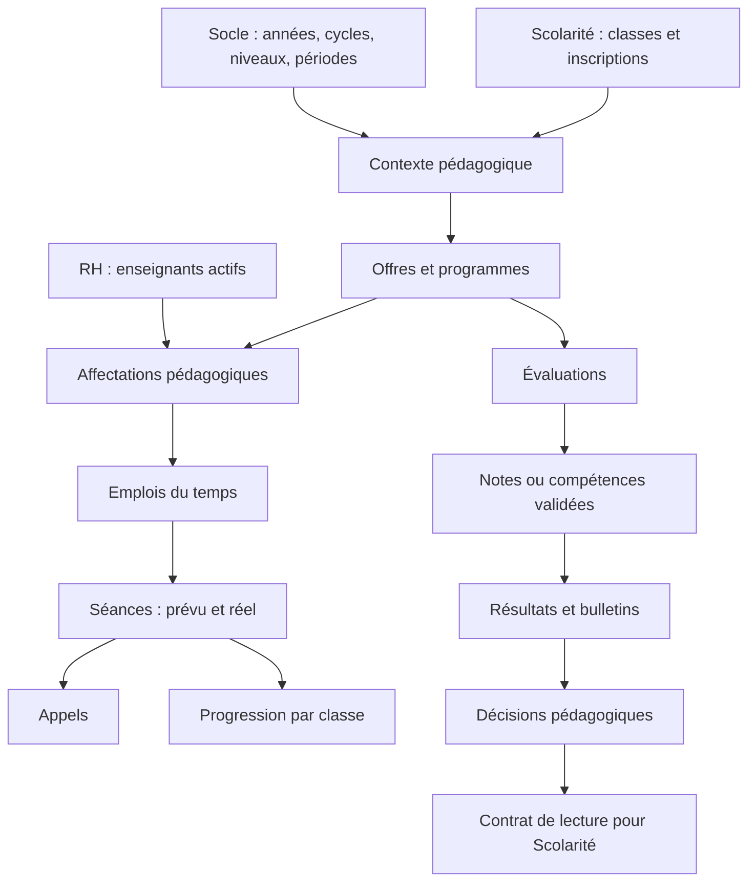

# Audit du module 04 — Pédagogie

Date : 28 septembre 2026. Base inspectée : commit `f3596d9` et modifications locales présentes. Périmètre : phase 1 du cahier des charges fourni, avec propositions de conception à valider. Aucun développement fonctionnel du module n'est réalisé dans cet audit. La réparation des colonnes pédagogiques appartient à l'intervention précédente.

## 1. État du projet

Le monolithe modulaire comprend Socle (Administration), RH, Scolarité, Pédagogie, Finances, Assiduité, Communication, Vie scolaire, Logistique et Technique. Chaque module possède ses modèles, services, contrats, migrations et écrans Filament. Les services sont liés aux interfaces dans les ServiceProviders.

**Versions réellement verrouillées dans composer.lock : Laravel 13.25.0, Filament 5.7.6, Livewire 4.4.0.** Le prompt mentionne Laravel 12 : conserver les versions installées, sans rétrogradation.

Des changements locaux Scolarité/Finances et interface sont en cours. Ils doivent être préservés et ne pas être intégrés implicitement à une refonte pédagogique.

### Schéma réel : ne pas se fier uniquement à migrate:status

La base MySQL locale a été inspectée en lecture seule pendant cet audit. La précédente réparation a rétabli les champs de workflow de `notes`, `emplois_du_temps`, `programme_chapitres` et `presences`.

D'autres différences subsistent entre le schéma réel et les migrations du dépôt :

- `offres_pedagogiques.classe_id` manque, alors que le code et les migrations du 12 septembre le prévoient ;
- `programmes.offre_pedagogique_id` manque également ;
- `programme_chapitres.parties` manque, malgré une migration du 13 septembre ;
- `classes.professeur_principal_id` et `professeur_adjoint_id` existent dans la base. Ils ne représentent pas plusieurs assistants avec périmètres et historique.

Prévoir d'abord une réparation additive contrôlée et l'examen des index réels associés. Ne pas rejouer aveuglément toutes les anciennes migrations, ni réinitialiser la base.

## 2. Existant réutilisable et écarts

| Domaine | Existant | Écart avec le besoin |
|---|---|---|
| Navigation | Tableau de bord + six pages de regroupement | Renommer/regrouper selon les sept entrées demandées ; conserver les anciennes URL ou leurs redirections |
| Matières/domaines | `Matiere`, `CategorieMatiere`, `MatiereService`, ressources | Ajouter une nature configurable matière/domaine/activité sans nouveau catalogue concurrent |
| Offre | `OffrePedagogique`, coefficient annuel, volume, niveau, classe prévue par migration | Stabiliser l'offre commune au niveau et l'éventuelle adaptation par classe ; réparer le schéma |
| Affectations | `AffectationPedagogique` avec enseignant, matière obligatoire, classe, année | Aucun principal/assistant généraliste ; pas de périmètre multimatière ni de période d'effet |
| Programmes | `Programme`, `ProgrammeChapitre`, import documentaire, validation, parties JSON | Pas de leçon structurée autonome ; protéger l'historique et organiser les versions |
| Progression | `Progression` rattachée à une séance dispensée et un chapitre | Calcul insuffisamment isolé par classe et année ; confusion chapitre entamé/terminé |
| Planning | `CreneauHoraire`, `EmploiDuTemps`, détection de chevauchements | Vérifier l'affectation métier côté serveur, les salles nulles et les écritures concurrentes |
| Séances | Génération hebdomadaire idempotente, transitions et report | Formaliser enseignant prévu/réel, remplacements, horaires historiques et liens leçon |
| Appels | `Presence`, appel depuis séance, anomalie sans appel | Vérifier l'inscription des élèves et l'autorisation enseignant dans le service ; dissocier appel et fin de séance |
| Évaluations | `Evaluation`, type, barème, coefficient, période, validation du sujet | Séparer validation du sujet et fin de saisie ; ajouter le mode compétences/appréciations |
| Notes | `NoteService`, délai de modification, déblocage exceptionnel audité | Compléter soumission/validation/verrouillage ; sécuriser tous les chemins d'écriture, dont absence |
| Résultats | Calcul pondéré et classement dans `BulletinService` | Exclure les notes non validées ; adapter règles, échelles et rang selon contexte |
| Bulletins | `Bulletin`, `BulletinMatiere`, `BulletinMatiereNote`, `BulletinVersion`, PDF, publication | Réutiliser le moteur avec présentations et règles par cycle, sans trois moteurs |
| Décisions | `ConseilClasse`, `DecisionConseil` | Service métier et contrat de lecture pour Scolarité ; ne pas modifier les réinscriptions directement |

### Défauts fonctionnels précis à traiter

- `AffectationPedagogiqueResource::normaliserEtValider()` impose encore une matière en Maternelle/Primaire. La validation métier se trouve dans la Resource.
- `classeEstSecondaire()` reconnaît `COL` et `LYC` en dur. La base contient **MAT, PRI, COL, LYC**, et non trois lignes de cycles.
- `RH/Services/EnseignantService::estAffecteA()` interroge le référentiel RH `enseignant_matiere_niveau` et compare `niveau_id` à l'argument `classeId`. Ce référentiel ne doit pas faire concurrence aux affectations pédagogiques.
- `ProgressionService` modifie le statut partagé du chapitre ; son pourcentage compte les chapitres ayant une progression sans filtrer les séances par classe/année ni exiger `chapitre_termine`. Son calcul de retard utilise l'année `1` et ne compare pas réellement une échéance.
- `EmploiDuTempsService` vérifie les chevauchements mais pas l'autorisation d'enseigner la matière/classe. Les contrôles avant insertion ne suffisent pas, seuls, à gérer la concurrence.
- `PresenceService::faireAppel()` accepte les identifiants fournis sans vérification des inscriptions dans cette méthode et passe automatiquement la séance à « dispensée ». Le taux de présence ignore actuellement la période reçue.
- `NoteService::enregistrerAbsence()` emploie `updateOrCreate` sans reprendre le contrôle de verrouillage de la saisie numérique. `Note` porte un trait d'audit mais pas de protection modèle suffisante contre toutes les modifications directes d'une note verrouillée.
- `BulletinService` sélectionne les évaluations validées, mais ne filtre pas le statut des notes ; la conversion et les appréciations restent basées sur 20. Les élèves sans note risquent d'être absents de l'effectif calculé.

Ces constats proviennent du code ; les tests actuels ne couvrent pas tous ces scénarios.

## 3. Propriétaires et relations inter-modules

| Propriétaire actuel | Données / contrats à réutiliser | Adaptation proposée |
|---|---|---|
| Socle | `Cycle`, `Niveau`, `AnneeScolaire`, périodes ; `AnneeScolaireServiceContract`, `ParametrageServiceContract`, `AuditServiceContract`, documents | Conserver leur emplacement actuel. Exposer des DTO de contexte plutôt que déplacer les référentiels pour suivre littéralement le prompt |
| Scolarité | `Classe`, `Eleve`, `Inscription` ; `ClasseServiceInterface`, `EleveServiceInterface` | Étendre les lectures avec année/cycle/niveau, élèves inscrits et contexte de classe |
| RH | `Employe`, `Enseignant`, qualifications, contrats, remplacements RH ; `EnseignantServiceInterface` | Exposer enseignants actifs et identité en lot ; Pédagogie possède l'affectation classe/matière |
| Pédagogie | Offres, affectations, programmes, séances, appels, évaluations, résultats, décisions | Définir une seule source d'autorisation d'enseigner ; conserver la trace des références externes |
| Logistique | Salles via ses contrats | Vérifier existence/disponibilité sans importer ses modèles |
| Communication / Assiduité / Vie scolaire | Événement `ReportCardPublished` et contrats existants de consultation | Produire événements/contrats publics ; les traitements parentaux ou disciplinaires restent chez leurs propriétaires |

## 4. Architecture et autorisations

`deptrac.yaml` autorise Pédagogie à utiliser ses contrats et ceux du Socle, de Scolarité, RH et Logistique. Le commentaire du constructeur d'`EmploiDuTempsService` affirmant que RHContracts serait interdit est obsolète.

`BulletinService → Scolarite\Models\Classe` est une exception explicite actuelle. Plusieurs écrans et services lisent aussi directement `classes`, `cycles`, `enseignants`, `employes`, etc. via `DB::table`. Deptrac ne détecte pas la dépendance sémantique des noms de tables : une analyse sans violation ne suffirait donc pas.

Résultat de l'analyse exécutée : **6 violations, 69 violations ignorées, 0 avertissement**. Les six violations concernent `EleveResource`, `CreateEleve`, `EditEleve` dépendant de `Finances\Models\FacturePreinscription`. Elles sont antérieures à cet audit et ne doivent pas être dissimulées par une nouvelle exception générale.

Les habilitations passent par `ModuleAccess`, `HabilitationCatalog`, `habilitation-catalogue.json` (fichier réel : `app/Filament/Support/habilitations-catalogue.json`), les services Socle, les rôles Spatie et certaines restrictions dans les actions. Codes déjà présents : `pedagogie.enseignements`, `programmes`, `emplois_du_temps`, `seances`, `evaluations`, `bulletins`, `discipline`, ainsi que `consulter`, `modifier`, `executer`, `imprimer`. Réutiliser ces conventions et ajouter les opérations sensibles manquantes (saisir, valider, déverrouiller, publier), avec contrôle serveur. Une permission d'accès au menu ne remplace pas le périmètre classe/matière de l'enseignant.

Pas de répertoire d'enums ou de policies propres à Pédagogie repéré ; conserver les valeurs stockées et introduire des enums compatibles, sans renommage massif de statuts historiques.

## 5. Modèle recommandé

1. **Conserver** les modèles et tables existants listés ci-dessus ; ne pas créer `MatiereDomaine` en parallèle de `Matiere`, ni une nouvelle table d'élèves/classes.
2. Enrichir `AffectationPedagogique` avec `type` (principal, assistant, matière), dates d'effet et matière nullable pour principal/assistant. Ajouter un pivot `affectation_pedagogique_matieres` pour les assistants spécialisés. Assistant généraliste : aucun périmètre restreint. Le service vérifie l'année, le contexte de classe et les chevauchements temporels.
3. Garantir un seul principal sur une même classe/période par transaction et verrouillage d'un contexte stable, plus contraintes SQL adaptées au moteur. Un index unique contenant une colonne nullable ne suffit pas à cette règle.
4. Garder l'offre annuelle de niveau, avec adaptation par classe si retenue. Établir explicitement la priorité classe/niveau et figer le coefficient dans les résultats publiés. Conserver les coefficients historiques de matière comme valeurs de reprise, pas comme vérité annuelle.
5. Ajouter `ProgrammeLecon` sous `ProgrammeChapitre`, avec ordre, objectifs et volume. Reprendre les parties JSON existantes avec traçabilité, après réparation du schéma. Conserver les programmes utilisés ; archivage plutôt que suppression physique.
6. Enrichir `Seance` avec enseignant prévu/réel, horaires et contexte figés, remplacement/report, observations. Réutiliser `Progression` pour le contenu enseigné et un pivot de leçons traitées si plusieurs leçons par séance. Calculer l'avancement sur les séances réalisées de la classe et de l'année ; ne plus utiliser le statut global d'un chapitre comme progression commune.
7. Réutiliser `Evaluation`/`Note` pour le quantitatif et ajouter des tables structurées de compétences, critères et acquisitions si le mode qualitatif est confirmé. Ne pas encoder une appréciation dans une note numérique artificielle.
8. Ajouter des règles pédagogiques versionnées par année et contexte : barème cible, mode d'évaluation, traitement des absences/manquants, arrondi, rang. Un service `ResultatService` applique ces règles ; les tables de détail/version de bulletin conservent le résultat publié.
9. Réutiliser `ConseilClasse` et `DecisionConseil`, avec décisions configurables et service transactionnel audité. Exposer la décision validée à Scolarité via un contrat, sans écriture dans l'inscription suivante.

## 6. Plan fichier par fichier proposé

Tous les chemins ci-dessous sont relatifs au dépôt ; les noms des nouveaux fichiers restent une proposition.

| Phase | Fichiers existants à adapter | Nouveaux fichiers ciblés |
|---|---|---|
| Réconciliation | migrations Pédagogie des 12/13 septembre ; aucune modification rétroactive proposée | `app/Modules/Pedagogie/database/migrations/*_reparer_contexte_offres_programmes.php`, test de réparation |
| Contexte | `Socle/Contracts/AnneeScolaireServiceContract.php`, `Scolarite/Contracts/ClasseServiceInterface.php`, `Scolarite/Services/ClasseService.php`, `Scolarite/Contracts/EleveServiceInterface.php`, `Scolarite/Services/EleveService.php`, `RH/Contracts/EnseignantServiceInterface.php`, `RH/Services/EnseignantService.php` sous `app/Modules/` | DTO/contrat de lecture dédié lorsque l'interface actuelle ne convient pas ; pas de modèle partagé concurrent |
| Organisation | `Pedagogie/Models/Matiere.php`, `OffrePedagogique.php`, `AffectationPedagogique.php` ; leurs Resources et pages Create/Edit/List | `Pedagogie/Contracts/AffectationPedagogiqueServiceInterface.php`, `Services/AffectationPedagogiqueService.php`, `Services/OffrePedagogiqueService.php`, `Enums/TypeAffectationPedagogique.php`, pivot |
| Programmes | `Models/Programme.php`, `ProgrammeChapitre.php`, `Progression.php` ; `Services/ProgrammeService.php`, `ProgrammeDocumentParser.php`, `ProgressionService.php` ; contrats et Resources correspondants | `Models/ProgrammeLecon.php`, relation/pivot de progression par leçon, tests comparatifs de classes |
| Planning | `Services/EmploiDuTempsService.php`, `Contracts/EmploiDuTempsServiceInterface.php`, `Models/EmploiDuTemps.php`, `CreneauHoraire.php`, `Filament/Resources/EmploiDuTempsResource.php` et pages | Validateur métier d'affectation et tests de concurrence ; pas de second planning |
| Exécution | `Models/Seance.php`, `Services/SeanceService.php`, `PresenceService.php`, `DetectionAbsenceService.php` ; contrats et Resources Séance/Présence | Historique de remplacement si la simple trace prévu/réel ne suffit pas ; événements publics d'appel/progression |
| Évaluation | `Models/Evaluation.php`, `Note.php` ; `Services/EvaluationService.php`, `NoteService.php` ; contrats et Resources | `Filament/Pages/SaisieNotes.php`, service/contrat de workflow, règles/policies d'accès ; modèles de compétences selon décision |
| Résultats | `Services/BulletinService.php`, `Models/Bulletin*.php`, `ConseilClasse.php`, `DecisionConseil.php`, `Filament/Resources/ConseilClasseResource.php`, `BulletinResource.php`, vues `bulletin*.blade.php` | `Services/ResultatService.php`, `Services/DecisionPedagogiqueService.php`, contrat public de décision, règles versionnées |
| Navigation/style | `app/Filament/Support/ModuleNavigation.php`, `ModuleExperience.php`, `AdministrationHelp.php` ; `Pedagogie/Filament/Pages/Enseignements.php`, `ProgrammesProgression.php`, `EmploisDuTemps.php`, `SeancesAssiduite.php`, `EvaluationsResultats.php`, `BulletinsConseils.php`, `PedagogieDashboard.php` et leurs vues | `Pedagogie/Services/PedagogieDashboardService.php` pour sortir les agrégats de la page |
| Habilitations | `app/Filament/Support/habilitations-catalogue.json`, `ModuleAccess.php` si nécessaire, seeders/migrations d'habilitations existants | Permissions sensibles complémentaires et tests par rôle/périmètre |
| Intégration | `app/Modules/Pedagogie/PedagogieServiceProvider.php`, `deptrac.yaml` uniquement pour contrats légitimes | Bindings des nouveaux services ; aucun assouplissement général des frontières |

## 7. Migrations envisagées

- Réparation additive du contexte offres/programmes/parties et vérification des contraintes manquantes.
- Extension des affectations, pivot des matières d'assistants, périodes d'effet, index de recherche année/classe/enseignant ; reprise contrôlée des titulaires/adjoints existants, avec rapport des ambiguïtés.
- Configuration du mode d'organisation à partir des cycles existants ; aucune suppression/fusion automatique de COL/LYC.
- Leçons de programmes et liens de progression, reprise des parties structurées.
- Enrichissement des séances et références de remplacement/report ; conservation des références historiques.
- Règles versionnées d'évaluation et, si validé, compétences/critères/acquisitions.
- Traçabilité des transitions, archivage des programmes et décisions configurables là où les champs actuels sont insuffisants.

Les migrations existantes sont conservées. Sauvegarde et contrôles de données avant reprise ; pas de `migrate:fresh`. Ne pas introduire de FK inter-module contraire aux conventions : identifiants externes validés via contrats, FK restrictives et uniques à l'intérieur de Pédagogie. Les contraintes exactes seront finalisées après inventaire des doublons et index de la base cible.

## 8. Notre style, conservé

Utiliser `app/Filament/Support/AmbassadorsDesign.php` (`configureTable`, `goldenFormModal`, `goldenDialogModal`), `RecordModal.php`, la configuration globale d'`AppServiceProvider`, `ModuleExperience`, les vues partagées et `resources/css/filament/admin/theme.css`.

- Menus : Tableau de bord ; Organisation pédagogique ; Programmes & progression ; Emplois du temps ; Séances & appels ; Évaluations & notes ; Résultats & bulletins.
- Une responsabilité par sous-écran, filtres de contexte cohérents, aide bleue avec icône information.
- Création/consultation/modification dans les modales du socle, aux dimensions déjà définies ; actions courtes en dialogue.
- Consultation d'une ligne avec accès Modifier et, seulement si l'historique l'autorise, Supprimer ; sinon Archiver.
- Saisie d'une classe entière dans un écran dédié utilisant le même tableau, sans comprimer une grande grille dans une petite modale.
- Tableau de bord opérationnel avec données réelles et « À traiter », sans graphiques décoratifs ni thème CSS propre à Pédagogie.

Le helper de modales ne remplace pas les services métier : les actions existantes ayant des hooks particuliers doivent être raccordées explicitement pour ne pas contourner leurs validations.

## 9. Vérifications et tests

Exécution de référence pendant cet audit : **37 tests réussis, 89 assertions** (dossier `tests/Feature/Pedagogie`, verrouillage des notes, programmes enseignants, réparation de schéma et parseur de programme). Cela ne constitue pas une validation de la suite complète ni de toutes les règles du nouveau cahier des charges.

À compléter par des tests ciblés :

| Fichier proposé/existant | Scénarios |
|---|---|
| `Pedagogie/AffectationPedagogiqueTest.php` | principal unique, plusieurs assistants, spécialisé/généraliste, matière Secondaire, dates, enseignant inactif, doublons concurrents |
| `Pedagogie/EmploiDuTempsTest.php` | conflits classe/enseignant/salle, salle absente, affectation obligatoire, cours adjacents permis, concurrence |
| `Pedagogie/SeanceTest.php` | génération idempotente, remplacement conservant le prévu, report, annulation et horaires historiques |
| `Pedagogie/PresenceTest.php` | seuls élèves inscrits, enseignant autorisé, appel incomplet, absence/retard, période de taux de présence, appel distinct de fin de cours |
| `Pedagogie/ProgressionTest.php` | séance réalisée obligatoire, leçons partielles, chapitre terminé, isolation entre classes/années, retard réel |
| `Pedagogie/EvaluationWorkflowTest.php` | contexte, barèmes variables, types d'examens, compétences et validation de sujet |
| `Pedagogie/NoteWorkflowTest.php`, `PedagogieNoteLockTest.php` | saisie collective, validation, verrouillage, correction motivée, refus d'absence ou modification directe contournant le verrou |
| `Pedagogie/BulletinCoefficientsTest.php`, `Pedagogie/ResultatsTest.php` | notes validées seulement, coefficient historique, absents et notes manquantes, rang désactivé, arrondis, trois présentations de bulletin |
| `Pedagogie/DecisionPedagogiqueTest.php` | décision validée et auditée, lecture par Scolarité sans création de réinscription |
| `Pedagogie/PermissionsTest.php`, tests Livewire | accès par rôle et affectation, actions directes interdites, sept menus, modales communes et état vide |
| Test de migration + MySQL CI + Deptrac | reprise partielle sans perte, contraintes effectives, frontières entre modules |

## 10. Décisions fonctionnelles à valider

1. **Secondaire** : recommandation de conserver les quatre référentiels actuels et de regrouper Collège/Lycée dans un contexte pédagogique « Secondaire », configurable. Une fusion des données n'est pas recommandée.
2. **Évaluation** : quelles échelles de compétences en Maternelle, quel mode en Primaire, quels barèmes et classement selon cycle ? Les rendre paramétrables ; ne pas inventer des seuils.
3. **Notes absentes/manquantes** : exclusion, zéro, rattrapage, et conditions empêchant la publication d'un bulletin incomplet à préciser.
4. **Validation** : qui valide les notes et bulletins ; qui peut déverrouiller ? Conserver provisoirement la règle actuelle « Fondateur pour correction exceptionnelle » jusqu'à décision contraire.
5. **Offre et titulaires** : recommandation d'offre annuelle commune au niveau avec adaptation par classe et un principal actif à une date donnée. Confirmer les remplacements temporaires et la reprise des champs principal/adjoint existants.

Prochaine étape après validation : conception détaillée et socle Organisation pédagogique, tests compris, puis progression par phases du document. Pas de déploiement ni de synchronisation Mac pendant cet audit.
